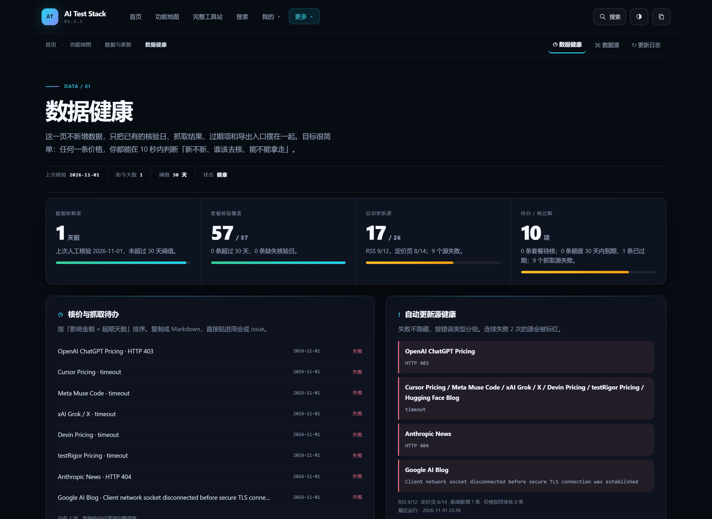
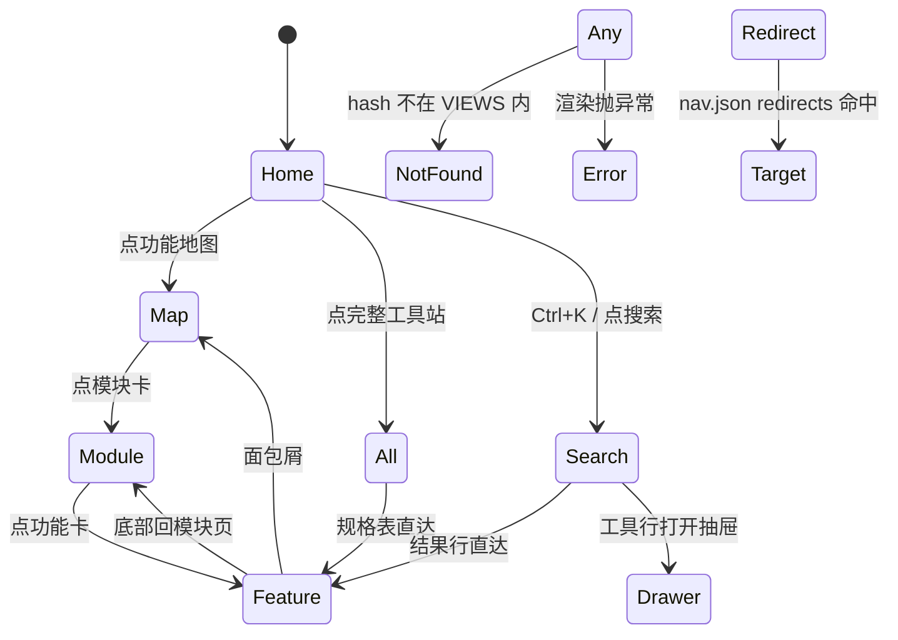
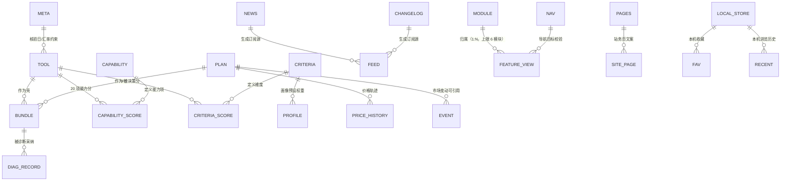

# AI Test Stack V2.3 完整版需求文档

> 本文档描述 AI Test Stack 站点的**完整目标状态**（V2.3），覆盖 6 个内容模块 × 24 个功能页、
> 7 个站务页、3 个导航页、6 个模块页与 2 个系统页，共 42 个视图。
> 本文只写「站要长什么样、怎么运转」，不写测试用例，不做需求评审。

---

## 1. 文档概览

| 项目 | 内容 |
|------|------|
| 项目名称 | AI Test Stack |
| 文档类型 | 开发视角完整版需求文档 |
| 目标版本 | V2.3（基线 V2.2.1） |
| 生成时间 | 2026-11-02 |
| 需求来源 | 用户口述《完整网站检查清单》（2026-11-02，10 大项 60 小项） |
| 实现基准 | `src/*`、`data/*.json`、`build.js` 的实际实现即本项目的「原型」，界面与字段以它为准 |
| 适用形态 | 单文件静态站，零运行时依赖，`file://` 可打开，无后端 |
| 数据核验日 | 2026-11-01 ｜ 构建日 2026-11-02 ｜ 汇率 USD = 7.25 |

### 1.1 信息来源（逐份登记）

| # | 材料 | 路径 / 来源 | 负责回答什么问题 |
|---|------|-------------|------------------|
| M1 | 用户口述需求清单 | 2026-11-02 会话，《完整网站检查清单》 | 本期要补哪些页面、导航、交互、UI 与动效、合规项 |
| M2 | 差距核对结果 | `docs/GAP-ANALYSIS.md` | 逐条核对现状：已有 / 部分 / 缺失 / 不适用，以及真实缺口 9 项 |
| M3 | 产品范围与边界 | `docs/PRODUCT-v6.md` | 系统定位、空位论证、**明确不做**的清单、成功标准 |
| M4 | 视觉规范与令牌 | `docs/DESIGN-v7.md` | 颜色 / 字号 / 圆角 / 间距令牌、组件改造口径、响应式与可访问性 |
| M5 | 视觉验收记录 | `docs/ACCEPTANCE-v7.md` | 35 视图 × 双主题 0 违规、23 组断言全过的实测结果 |
| M6 | 站内结构与数据契约 | `README.md` | 三层结构、订阅形态、组合与诊断口径、已知限制、断言清单 |
| M7 | 发布与维护流程 | `docs/MAINTAIN.md` | 门禁命令、四类日常更新场景、发布红线、排查表 |
| M8 | 数据事实源 | `data/*.json`（27 个文件） | 条目计数、字段定义、枚举取值、核验日 |
| M9 | 实现现状 | `src/index.html`、`src/app.js`、`src/v4–v8.css` | 路由、视图、渲染逻辑、现有交互行为 |
| M10 | 自动化现状 | `.github/workflows/*.yml` | 部署、每周抓取、每日探活、依赖升级 |

### 1.2 口径优先级

界面流程、字段名称、按钮文案、筛选项、枚举取值、示例数据，**一律以站内实际实现（`src/` + `data/`）为准**；
视觉样式以 `docs/DESIGN-v7.md` 与 `src/v8.css` 为准；业务文档（M3、M6、M7）只补充业务流程、
范围边界与计算规则，不覆盖界面字段。用户当轮明确指令可临时调整口径。

本文标注约定：

- 直接事实：能指回表格中的 M1–M10 或具体文件；
- 他人观点：注明出处（如 M3 的产品判断）；
- **假设**：标注「假设」，表示按合理默认推进、未经确认；
- 待确认：进入第 12 章，不在正文写死。

### 1.3 本期做 / 不做速览

- **本期做**：补齐 7 个站务页（搜索 / 个人中心 / 反馈 / 关于 / 帮助 / 隐私与条款 / 联系方式）
  与 1 个渲染出错兜底页；模块由 7 个并为 6 个并加旧地址重定向；导航改为配置驱动；
  完整工具站扩成五分类平铺；新增收藏与浏览历史；首页减字并加动效层；新增首屏骨架。
- **本期不做**：账号体系、后端 API、数据库、权限与数据隔离、测试社区本体、
  自动改价、薪资与 JD 采样、团队采购与席位计算。

---

## 2. 系统定位、端与角色

### 2.1 一句话定位

给**测试工程师**用的选型决策站：回答「买什么、我在哪、行业在变什么、下一步做什么」，
所有价格有出处、所有判断署了名，且可以离线打开、可以自己维护。

> 出处：M3 §0、M6 开篇。M3 明确本站在同类中的空位是「用同一套证据标准把四件事串成一条决策链」，
> 而不是「再加一个榜单」。

### 2.2 端与角色清单

本项目**只有一个端**：浏览器。没有服务端程序，因此没有传统意义上的多角色、多端与权限模型。

| 端 / 角色 | 定位 | 操作者 | 本期状态 |
|---|---|---|---|
| 浏览端（`file://` 双击打开） | 离线可用的完整站点 | 任意用户 | ✅ 本期实现 |
| 浏览端（`https://` GitHub Pages 子路径） | 在线版，含订阅源 / 分享图 / 离线缓存 | 任意用户 | ✅ 本期实现 |
| 数据维护者 | 改 `data/*.json` → 跑门禁 → 推送 | 仓库维护者 | ✅ 本期实现（命令行，非界面） |
| 数据贡献者 | 提数据纠错 Issue / PR | 外部访客 | ✅ 本期实现（走 GitHub Issues） |
| 账号体系（注册 / 登录 / 个人云档案） | 跨设备同步收藏与组合 | — | ❌ 本期不做，见 11 章 |
| 测试社区（技能 / MCP / 插件推荐、实时数据） | 内容共建与交流 | — | ❌ 本期不做，仅预留导航位 |

### 2.3 外部依赖

| 依赖 | 用途 | 是否必需 | 缺失时的降级 |
|---|---|---|---|
| GitHub Pages | 托管线上版 | 否 | 双击本地 `index.html` 即可用，功能一致 |
| GitHub Issues | 接反馈与数据纠错 | 否 | 退化为「复制反馈模板到剪贴板」，页面不报错 |
| 官方 RSS / 定价页 | 自动抓取新闻与价格指纹 | 否 | 抓失败照实列在数据健康页，不影响人工条目 |
| Google Fonts 等字体 CDN | — | 不使用 | 全站用系统字体栈 |

> **本站不引用任何第三方 CDN、统计工具、广告或字体服务**，也没有 cookie。这条是硬约束，
> 见第 11 章与 `docs/MAINTAIN.md` §6。

---

## 3. 核心领域模型（信息架构）

### 3.1 视图层级

```text
站点（单文件 index.html）
├── 导航层（3）      #home 首页 · #map 功能地图 · #all 完整工具站
├── 内容模块（6）     每个模块一页 #mod-<id>，聚合该模块下的功能页
│   ├── #mod-diagnose  诊断与判断   ── 6 个功能页
│   ├── #mod-grow      角色与成长   ── 5 个功能页
│   ├── #mod-shift     变局与大事   ── 2 个功能页
│   ├── #mod-toolkit   工具与方案   ── 4 个功能页
│   ├── #mod-choose    选择与资源   ── 4 个功能页
│   └── #mod-data      数据与更新   ── 3 个功能页
├── 功能页（24）     一级视图，模块内导航可横向互跳
├── 站务层（7）      #search · #mine · #feedback · #about · #help · #privacy · #contact
└── 系统页（2）      #404 页面不存在 · #error 渲染出错兜底
```

计量关系：

- 一个功能页**有且仅有**一个归属模块（构建期强制，重复归属直接报错）；
- 一个模块**至少**有一个功能页；
- 站务页**不属于**任何模块，面包屑只到「首页 › 页名」；
- 模块数**上限 6**（构建期强制）。这条是信息架构硬约束：功能地图一屏放得下 6 个大模块，
  第 7 个开始用户就要做「扫描 + 排除」而不是「一眼扫过」。

> 出处：M1 一.2「功能地图页：5～6 个大模块」；`build.js` 的 `modules.json 应有 5–6 个模块` 断言。

### 3.2 页面层级与返回路径

每个内容页都必须处在一条**可回退**的路径上：

```text
首页 → 功能地图 → 模块页 → 功能页
                     ↑__________|            功能页底部常驻「回模块页 / 回功能地图」
首页 / 功能地图 / 完整工具站 / 搜索 ↗         任意页可平跳
```

| 层级 | 面包屑 | 模块内导航 | 底部引导 |
|---|---|---|---|
| 模块页 | 首页 › 功能地图 › 模块名 | 不显示 | 下一步 / 回功能地图 / 完整工具站 |
| 功能页 | 首页 › 功能地图 › 模块名 › 功能名 | 显示同模块其他功能，当前项高亮 | 同模块其他功能 / 下一步 / 收藏本页 / 报告本页问题 / 完整工具站 |
| 站务页 | 首页 › 页名 | 显示 功能地图 / 完整工具站 / 个人中心 | 继续（回首页等 5 个入口） |
| 导航页 | 不显示 | 不显示 | 各页自带 |

### 3.3 关键业务约束

1. 视图 id 一旦发布**不得改名**（旧 hash 链接必须继续可用）；确需变更时必须在
   `data/nav.json` 的 `redirects` 中登记映射。
2. 未知 hash 一律落到 `#404`，**不静默回落到首页**——死路也要看得见所有岔口。
3. 任何渲染异常必须被路由层接住并显示 `#error`，不允许白屏。
4. 站内所有数字（工具数、套餐数、最低月成本等）**运行时从数据算出**，模板里不得写死计数。
5. 导航三处（顶栏 / 页脚 / 移动端）必须来自同一份 `data/nav.json`，不得各自硬编码。

---

### 3.4 导航三处的分工

导航不是「到处放链接」，每一处只承担一种职责：

| 位置 | 职责 | 内容 | 数据来源 |
|---|---|---|---|
| 顶栏主导航 | 只放**大模块入口**，不平铺小功能 | 首页 · 功能地图 · 完整工具站 · 搜索 ｜「我的」下拉 ｜「更多」下拉 | `nav.json` → `primary` |
| 模块内子导航 | 只在进模块后出现，**只显示本模块的功能** | 面包屑 + 同模块其他功能（当前项高亮） | `modules.json` |
| 页脚 | 兜底全站入口，保证任何页面都能找到合规与联系信息 | 四组：逛站（含完整工具站）/ 内容 / 数据与留痕（数据健康 · 数据源 · 更新日志 · 订阅）/ 关于本站（关于 · 帮助 · 反馈 · 联系方式 · 隐私与条款 · 数据纠错） | `nav.json` → `footer` |
| 移动端面板 | 折叠后层级仍清楚，路径不丢 | 主链接（含搜索、个人中心）→ 模块 accordion → 功能 → 更多（含关于 / 反馈 / 联系 / 隐私） | `nav.json` → `mobile` |

**页脚必须包含**：完整工具站入口、更新日志、数据源、关于、隐私政策、联系方式。
这六项缺任何一项，用户在「想找合规说明」时就只剩地址栏可猜。

**社区预留位**同时出现在顶栏「更多」、页脚「关于本站」、移动端「更多」三处，
由 `nav.json` 的 `reserved` 统一渲染，不得在三处各写一份。

## 4. 内容模块详细需求

以下 6 个模块的归属配置在 `data/modules.json`，构建期校验「功能页不重不漏」。

### 4.1 诊断与判断（`#mod-diagnose`，6 个功能页）

**功能描述：** 回答「哪个工具对我最好」——不是「哪个工具最好」。使用场景：用户拿着预算
准备下单，但没有判断依据。

**代表性图片：**


**页面级详细说明：**

| 功能页 | 视图 | 页面说明 |
|---|---|---|
| 总览 | `#overview` | 数据工作台：当前画像下的结论、能力图谱速览、前三名、最近更新、七组直接答案 |
| 测试人诊断 | `#persona` | 4 道题 → 8 种类别之一；答完才出结果，结果页给类别、典型状态、建议组合 |
| 决策矩阵 | `#matrix` | 画像预设 + 9 维权重滑块 + 硬性条件（国内直连 / 可脚本化）+ 月预算上限；右侧实时重排 |
| 两两 PK | `#versus` | 任选两款逐维对比；九维差距 ≥1 分染色，20 项能力差距 ≥2 分才算「明显领先」 |
| 我的判断 | `#opinion` | 编辑立场：三种活法、四个争议、一条自检原则，每条写明「什么情况下不成立」 |
| 决策报告 | `#report` | 把诊断 + 组合 + 四项自检 + 30 天动作收成一页 A4；可打印、可复制 Markdown |

**字段规则表（决策维度，`data/criteria.json` → `criteria[]`）：**

| 字段名 | 必填 | 类型 | 取值 | 校验规则 | 错误提示 |
|---|---|---|---|---|---|
| `id` | 是 | string | 英文小写 | 与 `tools[].score` 的键对齐 | 工具缺少评分 `<id>` |
| `name` | 是 | string | 中文 | — | — |
| `icon` | 是 | string | Unicode 字符 | — | — |
| `profiles[].w` | 是 | object | 9 个键，值 0–10 | 键必须覆盖全部维度 | — |

**字段规则表（诊断题，`data/persona.json`）：**

| 字段名 | 必填 | 类型 | 取值 | 校验规则 | 错误提示 |
|---|---|---|---|---|---|
| `questions[].k` | 是 | string | 题目标识 | 4 道题 | — |
| `questions[].opts[].scores` | 是 | object | 类别 → 分值 | 每个类别至少出现在一个选项里 | 类别不可到达时构建报错 |
| `personas[].key` | 是 | string | 8 种类别之一 | 并列第一由固定优先级 `PERSONA_ORDER` 打破 | — |

**流程与操作逻辑：**

- 诊断作答：选一个选项 → 进入下一题 → 4 题答完 → 进入生成态（约 1.1 秒）→ 输出方案。
  **不做「边答边变」的实时反馈**，避免诱导用户为了看到想要的类型而改答案。
- 矩阵重排：拖动滑块 → 综合分 `Σ(权重 × 分数) / Σ权重` 实时重算 → 榜单与夺冠率分布同步刷新。
- 报告生成：读取诊断结果与已选组合 → 有则输出五段报告，无则显示空态引导去诊断或选组合。

**条件与限制：**

- 硬性条件勾选后，不满足的工具**置灰但保留在列表里**，便于看出「差在哪」，不直接隐藏。
- 预算上限为 0 时视为不限。

**异常与提示：**

| 场景 | 提示文案 / 行为 |
|---|---|
| 矩阵页两款选到同一款工具 | 直接提示，不计算「领先 0 分」 |
| 报告页无诊断也无组合 | 空态 3 个 CTA，引导去诊断 / 选组合 |
| 分享链接里的权重参数非法（如 `w=999`） | 忽略该参数退回默认，不白屏 |

**业务规则：**

- 评分是编辑判断，不是跑分；页面标「本站判断」，依据写在卡片里。
- 反利益冲突：本站诞生于 DeepSeek Harness，DSH 天然是「亲儿子」，因此评分经重新校准，
  并加蒙特卡洛门禁（见 7.2）。

### 4.2 角色与成长（`#mod-grow`，5 个功能页）

**功能描述：** 回答「我该往哪走」——不是「我该买什么」。使用场景：用户担心岗位被替代，
需要一份可核对的定位与补位方案。

**代表性图片：**


**页面级详细说明：**

| 功能页 | 视图 | 页面说明 |
|---|---|---|
| 测试角色阶梯 | `#roles` | 「用 AI 测 / 测 AI / 与 AI 协作 / 防 AI 风险」四象限；11 个角色三梯队；初/中/高差异；同名角色三级分水岭矩阵 |
| 能力图谱 | `#capabilities` | 20 项能力 × 29 款工具热力图，每格 1–5 分；可按均值或名称排序；最右列横向均值 |
| AI 测试专项 | `#aitest` | 只回答「做测试的人该用哪些工具」；按 `maturity` 标注成熟度；按阶段给建议 |
| AI 评测集 | `#evalset` | 30 条用例，6 类各 5 条，每条含输入、预期、判定器、严重级别；可筛选、搜索、复制、下载 |
| 成长路线 | `#roadmap` | 4 阶段路线，以产出物验收；三档预算组合；三个坚持的判断 |

**字段规则表（能力项，`data/capabilities.json`）：**

| 字段名 | 必填 | 类型 | 取值 | 校验规则 | 错误提示 |
|---|---|---|---|---|---|
| `groups[].items[].id` | 是 | string | 英文小写 | 与 `tools[].capabilities` 的键对齐 | 工具缺少能力分 `<id>`（警告） |
| `groups[].items[].name` | 是 | string | 中文 | — | — |
| `groups[].items[].desc` | 是 | string | 中文一句话 | — | — |
| `levels[].v` | 是 | number | 1–5 | 五级定义齐全 | — |

**字段规则表（评测用例，`data/evalset.json` → `cases[]`）：**

| 字段名 | 必填 | 类型 | 取值 | 校验规则 | 错误提示 |
|---|---|---|---|---|---|
| `id` | 是 | string | 唯一 | 不得重复 | 用例 id 重复 |
| `cat` | 是 | string | 6 类之一 | 每类 ≥4 条 | 类别不足时构建报错 |
| `input` | 是 | string | 文本 | — | 缺少 input |
| `expected` | 是 | string | 文本 | — | 缺少 expected |
| `oracle` | 是 | string | 文本 | 判定器，缺失即报错 | 缺少 oracle |
| `severity` | 是 | string | `P0` / `P1` / `P2` | 三值之一 | severity 非法 |
| `tags` | 是 | array | 字符串数组 | — | 缺少 tags |

**字段规则表（AI 测试专项，`data/aitest.json`）：**

| 字段名 | 必填 | 类型 | 取值 | 校验规则 | 错误提示 |
|---|---|---|---|---|---|
| `items[].maturity` | 是 | string | `stable` / `beta` / `experimental` | 三值之一 | maturity 无效 |
| `items[].what` / `why` / `pos` | 是 | string | 文本 | 三个都必填 | 缺少 `<字段>` |

**流程与操作逻辑：**

- 角色页：点阶段标签 → 过滤该梯队角色 → 点角色卡 → 展开「每天交付什么 / AI 接手什么 / 什么仍然只属于人」。
- 评测集：切类别或输入关键词 → 结果与「当前筛选的 JSON」同步更新 → 可复制全部或下载 `exports/evalset.json`。

**条件与限制：**

- 角色阶梯是地图不是 JD；不同公司同名岗位职责差异大，页面明确写「用它定位，不要用它谈薪」。
- 替代度是本站按任务结构做的判断，不是调研数据；判断依据写在表格最后一列。

**异常与提示：**

| 场景 | 提示文案 / 行为 |
|---|---|
| 评测集筛选无结果 | 「这个筛选下没有用例。换个关键词，或点『全部』。」 |
| 角色数据缺失 | 「数据缺失」，不渲染半个页面 |

**业务规则：**

- 能力图谱按季度重估，每次改动进更新日志。
- 「均值高不等于适合你」：Claude Code 均值最高但国内可用性是 1，对国内团队这一格直接否决。

### 4.3 变局与大事（`#mod-shift`，2 个功能页）

**功能描述：** 回答「行业正在变成什么样」——不是「今天有什么新闻」。使用场景：用户需要判断
自己做的事三年后还在不在。

**代表性图片：**


**页面级详细说明：**

| 功能页 | 视图 | 页面说明 |
|---|---|---|
| AI 大事 | `#news` | 国内 / 国外双线时间轴；模型 / 产品 / 价格 / 政策 / 资本 / 安全；**人工条目必须写「对测试的影响」**；自动条目单独标记、默认不显示 |
| AI 对测试的冲击 | `#impact` | 8 组调研数据、5 个变化、9 项活动替代度矩阵、90 天三段方案、6 条反模式、5 题自检 |

**字段规则表（新闻，`data/news.json` → `events[]`）：**

| 字段名 | 必填 | 类型 | 取值 | 校验规则 | 错误提示 |
|---|---|---|---|---|---|
| `id` | 是 | string | 唯一 | — | 新闻 id 重复 |
| `date` | 是 | string | `YYYY-MM-DD` | 格式 | 日期格式非法 |
| `region` | 是 | string | `cn` / `intl` | 二值之一 | region 非法 |
| `kind` | 是 | string | 六类之一 | 白名单 | kind 非法 |
| `title` | 是 | string | 文本 | — | 缺少 title |
| `body` | 是 | string | 文本 | — | 缺少 body |
| `impact` | 是 | string | 文本 | **人工条目必填** | 人工条目缺少「对测试的影响」 |
| `source` | 是 | string | URL | — | 缺少来源 |

> 出处：M6「人工条目必须写『对测试的影响』——只有标题没有影响的，等于没有信息」；
> `docs/MAINTAIN.md` §3.2 同口径。

**流程与操作逻辑：**

- 新闻筛选：地区 + 类型 + 关键词 + 「含自动抓取」开关，四者可组合；未打开开关时自动条目不出现。
- 冲击自检：勾选确实做到的事 → 实时给出所在档位与下一步。

**条件与限制：**

- 自动条目永远单独存放于 `data/news-auto.json`，**不覆盖也不搬进人工条目**。
- 自动条目只保证来源与时间，不保证 relevance，因此默认不显示。

**异常与提示：**

| 场景 | 提示文案 / 行为 |
|---|---|
| 筛选后无结果 | 「这个类型下没有记录」 |
| 自动抓取未运行过 | 数据健康页提示需先运行刷新脚本 |

**业务规则：**

- 只收录「会改变你工作方式」的条目，不搬运资讯。
- 抓取失败的源照实写出，不隐藏。

### 4.4 工具与方案（`#mod-toolkit`，4 个功能页）

**功能描述：** 回答「具体买什么、怎么落地」——把候选缩到一份 4 周动作清单。

**代表性图片：**


**页面级详细说明：**

| 功能页 | 视图 | 页面说明 |
|---|---|---|
| 工具库 | `#tools` | 29 款工具（23 编程外壳 + 6 AI 测试平台）；可按类型 / 地区筛、关键词搜；点卡开抽屉看完整档案 |
| 组合方案 | `#bundles` | 32 套「壳 + 电」组合：成本、六维评分、能干什么、坑在哪；支持场景筛选与「采纳」 |
| 我的组合 | `#stack` | 勾选工具壳与套餐，实时算月成本，四项自检（有壳 / 有电 / 能进 CI / 国内直连）；含额度计算器 |
| 落地执行包 | `#plan` | 把选定组合变成 4 周 10 个动作，每步带验收标准；可勾选、进度持久化、可导出 Markdown |

**字段规则表（工具，`data/tools.json`）：**

| 字段名 | 必填 | 类型 | 取值 | 校验规则 | 错误提示 |
|---|---|---|---|---|---|
| `id` | 是 | string | 唯一英文小写 | 不得重复 | tools.json 存在重复 id |
| `name` / `vendor` / `tagline` | 是 | string | 文本 | — | 缺少 id/name |
| `score` | 是 | object | 9 个维度各 1–5 | 键与 `criteria[].id` 对齐 | 工具缺少评分 `<维度>` |
| `capabilities` | 是 | object | 20 项各 1–5 | 键与能力项对齐 | 工具缺少能力分 `<项>`（警告） |
| `tags` | 是 | array | 字符串数组 | 缺失会导致页面白屏 | 缺少 tags |
| `link` / `verified` | 是 | string | URL / `YYYY-MM-DD` | — | — |
| `provenance` | 是 | object | 四级之一 | `official` / `measured` / `community` / `inferred` | 来源等级非法 |
| `cnDirect` | 是 | boolean | 真 / 假 | — | — |
| `license` | 是 | string | 文本 | — | — |

**字段规则表（套餐，`data/plans.json`）：**

| 字段名 | 必填 | 类型 | 取值 | 校验规则 | 错误提示 |
|---|---|---|---|---|---|
| `id` | 是 | string | 唯一 | — | 套餐 id 重复 |
| `price` | 是 | number | > 0 或 0（按量） | 与 `currency` 配套 | — |
| `currency` | 是 | string | `CNY` / `USD` | 二值之一 | currency 非法 |
| `form` | 是 | string | 五种形态之一 | `coding` / `token` / `agent` / `member` / `paygo` | form 非法 |
| `formName` | 是 | string | 中文形态名 | — | 缺少 formName |
| `quotaUnit` | 是 | string | 单位名 | — | 缺少 quotaUnit（警告） |
| `window` | 是 | string | 计费窗口 | — | 缺少 window（警告） |
| `overage` | 是 | string | 超限出路 | — | 缺少 overage（警告） |
| `verified` | 是 | string | `YYYY-MM-DD` | 缺失即进入核价待办 | — |
| `history[]` | 否 | array | `{date, price, note}` | 用于价格轨迹与变化时间线 | — |

**字段规则表（组合，`data/bundles.json`）：**

| 字段名 | 必填 | 类型 | 取值 | 校验规则 | 错误提示 |
|---|---|---|---|---|---|
| `tool` | 是 | string | 工具 id | 必须存在于 `tools.json` | 组合引用了不存在的工具 |
| `plan` | 是 | string | 套餐 id | 必须存在于 `plans.json` | 组合引用了不存在的套餐 |
| `monthlyCost` | 是 | number | 元 / 月 | 开源壳算 ¥0，只算套餐价 | — |
| `costBasis` | 是 | string | 文本 | 说明成本怎么算的 | — |
| `s` | 是 | object | 7 维各 0–10 | 含 `ease`（上手难度） | — |

**流程与操作逻辑：**

- 采纳闭环：组合卡「采纳」→ 工具壳与套餐**同时**写入本地组合 → 我的组合页月成本一致。
- 额度估算：输入每天小时数 / 每小时轮数 / 上下文规模 / 跑批占比 → 算出大概需要的 token 量
  → 按各家用量口径折算占用比例 → 输出三档结论（够用 / 刚好 / 不够）。
- 执行包：无方案时显示空态并引导选组合；有方案时按周渲染 10 个动作，勾选状态写入本地。

**条件与限制：**

- 硬性筛选「可脚本化」会把图形界面产品排除——它们能帮你写代码，但没法被测试平台当组件调用。
- 套餐建议只留一个主力，其余按量兜底。

**异常与提示：**

| 场景 | 提示文案 / 行为 |
|---|---|
| 工具库筛选无结果 | 「没有匹配的工具。试试『测试』『开源』『国内』。」 |
| 组合筛选无结果 | 「这个条件下没有匹配的组合。换个筛选试试。」 |
| 执行包无方案 | 空态引导去诊断或选组合 |
| 套餐表默认只显示 20 行 | 提供「显示全部」展开到 57 行 |

**业务规则：**

- 首月价不是价格：¥9.9 / ¥7.9 / ¥24.5 都是首月，做预算按标准价算；表里同时给「到期后」价格。
- 「不限量」都有滚动窗口（5 小时窗口 + 周窗口是行业惯例）。
- 报价制产品的区间不是标价：testRigor / mabl / QA Wolf 的数字只用于预算量级，页面已标注。

### 4.5 选择与资源（`#mod-choose`，4 个功能页）

**功能描述：** 回答「同样的工具，怎么少花钱」——比套餐、薅免费额度、避开过期活动。

**代表性图片：**


**页面级详细说明：**

| 功能页 | 视图 | 页面说明 |
|---|---|---|
| 套餐对比 | `#plans` | 57 档国内外套餐；按工具聚成阶梯；按用法与形态筛选；全量对比表；「只买一个订阅」建议；四个坑 |
| 优惠白嫖 | `#promos` | 免费额度（怎么拿 / 上限 / 坑）、首购优惠表（含到期后价）、四层叠加结构、省钱时段、四条判断、使用边界 |
| 白嫖地图 | `#free` | 34 条免费额度，四类；每条写清怎么领、上限、坑、过期；含 3 条反面案例与已过期活动 |
| 市场变动 | `#events` | 半年市场时间轴（7 条，均有官网依据）；价格轨迹折线；这张时间轴的局限 |

**字段规则表（免费额度，`data/freebies.json`）：**

| 字段名 | 必填 | 类型 | 取值 | 校验规则 | 错误提示 |
|---|---|---|---|---|---|
| `items[].trap` | 是 | string | **≥15 字** | 少于 15 字构建失败 | 缺少「坑在哪」 |
| `items[].cat` | 是 | string | 四类之一 | 白名单 | 分类非法 |
| `items[].region` | 是 | string | 地区 | 三值 | — |
| `items[].expiry` | 否 | string | `YYYY-MM-DD` | 过期条目保留做证据 | — |

**字段规则表（首购优惠，`data/promos.json` → `firstBuy[]`）：**

| 字段名 | 必填 | 类型 | 取值 | 校验规则 | 错误提示 |
|---|---|---|---|---|---|
| `list` | 是 | number | > 0 | 标准价 | — |
| `promo` | 是 | number | ≤ `list` | 必须为数字且不大于原价 | promo 大于 list |
| `ends` | 否 | string | `YYYY-MM-DD` | 已过期且未下架 → 构建失败 | 优惠已过期未下架 |

**字段规则表（市场变动，`data/events.json` → `events[]`）：**

| 字段名 | 必填 | 类型 | 取值 | 校验规则 | 错误提示 |
|---|---|---|---|---|---|
| `kind` | 是 | string | `price` / `cut` / `retire` / `form` / `launch` / `model` | 白名单校验 | kind 非法 |
| `date` | 是 | string | `YYYY-MM-DD` | 格式 | — |
| `source` | 是 | string | URL | 必须有官网依据 | — |

**流程与操作逻辑：**

- 套餐筛选：地区 → 用法排序 → 形态筛选，三者叠加；筛选后行数与总额实时更新。
- 免费额度：按类别与地区筛；已过期条目保留并标记，作为「免费额度会消失」的证据。
- 价格轨迹：只画有 2 个以上数据点的套餐；单点套餐单独列出，不硬画成水平线。

**条件与限制：**

- 五种订阅形态**计费单位根本不同**（请求次数 / Credits / AFP 积分 / 共享额度池 / Token 实际用量），
  混在一起比价会得出错误结论，页面强制按形态分组。
- 国际档位按 $1 = ¥7.25 折算，**仅用于同表比较**；下单以支付时汇率为准。

**异常与提示：**

| 场景 | 提示文案 / 行为 |
|---|---|
| 地区筛选下无多档套餐 | 「当前地区没有多档套餐。」 |
| 免费额度类别下无记录 | 「这个类别下还没有记录」 |
| 价格轨迹记录里出现 `price <= 0` | 画图前过滤——`price: 0` 表示「按量计费不是订阅」，画出来会被读成「降到 0 元」 |

**业务规则：**

- 只记录有官网链接能对上的变动；价格没变不代表没变过，只是没查到确证，宁可不写。
- 额度缩水、首月价 / 活动价、没查到来源的传闻，**不记**。

### 4.6 数据与更新（`#mod-data`，3 个功能页）

**功能描述：** 回答「凭什么信你」——出处、口径、新鲜度全部摆出来。

**代表性图片：**



**页面级详细说明：**

| 功能页 | 视图 | 页面说明 |
|---|---|---|
| 数据健康 | `#health` | 新鲜度、套餐核验覆盖、失败源分组、核价与抓取待办（可复制 Markdown）、8 个数据集导出、纠错入口 |
| 数据源 | `#sources` | 自动更新管线状态、40 条来源分组、评分口径、已知的不确定性 |
| 更新日志 | `#changelog` | 最近变化时间线（价格从多少到多少、哪天、为什么）+ 本站改动全记录 + 怎么更新这个站 |

**字段规则表（站点元信息，`data/meta.json`）：**

| 字段名 | 必填 | 类型 | 取值 | 校验规则 | 错误提示 |
|---|---|---|---|---|---|
| `version` | 是 | string | 语义化版本 | 必须与 `package.json` 一致 | 两处版本不一致 |
| `lastVerified` | 是 | string | `YYYY-MM-DD` | 格式 | 必须是 YYYY-MM-DD |
| `lastBuilt` | 是 | string | `YYYY-MM-DD` | 不得早于 `lastVerified` | 生成日期早于核验日期 |
| `staleAfterDays` | 是 | number | 30 | 超阈值标黄、两倍标红 | — |
| `fx.USD` | 是 | number | 7.25 | 仅用于同表比较 | — |

**字段规则表（更新日志，`data/changelog.json` → `[]`）：**

| 字段名 | 必填 | 类型 | 取值 | 校验规则 | 错误提示 |
|---|---|---|---|---|---|
| `date` | 是 | string | `YYYY-MM-DD` | 格式 | — |
| `title` | 是 | string | 文本 | — | 缺少 title |
| `body` | 是 | string | 文本 | — | — |
| `items[]` | 否 | array | 字符串数组 | — | — |

**流程与操作逻辑：**

- 核价待办：按「影响金额 × 超期天数」排序 → 一键复制成 Markdown，直接贴进周会或 issue。
- 纠错入口：命令面板 / 页脚 / 数据健康页三处，点一下打开预填标题的 issue 表单并复制上下文。
- 更新日志筛选：全部 / 只看价格 / 只看本站；默认显示 8 条，可「还有 N 条」展开。

**条件与限制：**

- 自动抓取**只告警，不改价**。抓错一个价格比不更新更糟。
- 自动任务只写 `news-auto.json`、`_price-snapshots.json`、`_refresh-report.json`，
  不碰 `tools.json` / `plans.json` / `promos.json` / `news.json`。

**异常与提示：**

| 场景 | 提示文案 / 行为 |
|---|---|
| 数据超过 30 天未核验 | 页面顶部条标黄 + 数据健康页标红，并给出「看数据源」入口 |
| 抓取源失败 | 按 HTTP / timeout / TLS 分组列出，不吞错；连续失败 2 次的源标红 |
| 从未运行过自动更新 | 「还没有运行过自动更新」并给出命令 |

**业务规则：**

- 三层可靠性分开报告，不合成一个「总成功率」：L1 新鲜度（100%）→ L2 新闻 RSS（高）→ L3 价格指纹（尽力而为）。
- 维护动作只有一句话：打开数据健康页，看核价待办，按它列的顺序核。

---

## 5. 完整用户主流程

**前置条件：** 用户打开 `index.html` 或线上地址即可，无需注册、无需授权、无需联网（在线版首次加载除外）。

### 5.1 端到端主流程

```text
1. 进站（#home）
   → 首屏骨架消失，hero 出现：一句话 h1 + 一句副标题 + 轮播「你要解决什么」+ 两个主按钮
   → 右侧 DIAG 选型引擎待命

2. 三问诊断（#home 右栏，或 #persona 深度诊断）
   问 1 你最想解决什么  → regress / design / learn / team
   问 2 每月愿意花多少  → 50 / 100 / 200 / 不限
   问 3 你的红线        → 国内直连 / 能进 CI / 都要 / 都不要
   -> 计算：按预算硬过滤，把目标与红线映射到组合的六维分，加权排序取第一
   -> 输出：方案名 + 壳/电/合计三段成本 + 理由 + 额度判断 + 风险 + 升级路径 + 四个出口
   -> 数据落点：诊断记录写入本机 ats_diag（上限 10 条）

3. 采纳（首页诊断台「采纳」/ 组合页「采纳」）
   -> 工具壳写入 ats_stack，套餐写入 ats_picked（同时写，不拆）
   -> 页面提示「已采纳「X」：壳 + 电已同步到下方组合，月成本 ¥N」

4. 核算（#stack 我的组合 + 额度计算器）
   -> 实时算月成本；四项自检：有壳 / 有电 / 能进 CI / 国内直连
   -> 额度估算输出三档结论：够用 / 刚好 / 不够

5. 落地（#plan 落地执行包）
   -> 4 周 10 个动作，每步带验收标准
   -> 勾选进度写入 ats_planprog，可导出 Markdown

6. 交付（#report 决策报告）
   -> 五段报告：结论 / 选型理由 / 四项自检 / 30 天动作 / 风险与数据日期
   -> 打印成 A4（约 2 页，隐藏导航）或复制成 Markdown 交给主管 / 采购

7. 回访与纠错
   -> 订阅 feed.xml 收更新；或从上次的分享链接回到同一份配置
   -> 发现价格错了 → 就地「纠错」→ 预填标题的 issue + 剪贴板模板
```

### 5.2 另一条主流程：只看不买

```text
1. 进站 → #map 功能地图（6 个模块）→ 选一个模块 → 模块页看小功能 → 进功能页
2. 或直接 #all 完整工具站 → 五个分类标签（功能 / 工具 / 套餐 / 组合 / 站务）→ 一张规格表里点走
3. 或 Ctrl+K / #search 输关键词 → 结果按类型分组 → 直接进
```

### 5.3 渠道对照

| 渠道 | 使用者 | 模式 | 本期状态 |
|---|---|---|---|
| 本地单文件 | 想离线用 / 想自己留档的人 | 双击打开，零依赖 | ✅ |
| 线上 Pages 子路径 | 从别人分享链接进来的人 | 完整功能 + 订阅源 + 分享图 + 离线缓存 | ✅ |
| 移动端浏览器 | 通勤 / 会议间隙 | 汉堡分层面板导航，路径与桌面一致 | ✅ |
| 打印 / PDF | 要把结论交出去的人 | 打印媒体展开全部视图 + 报告 A4 | ✅ |

**验收标准：** 没参加过任何讨论的人读完本节，应能复述「一个用户从进站到把报告交出去，
中间经过哪几步、每一步留下什么数据、在哪一步可能卡住」。

---

## 6. 站务层详细需求

站务层是本期新增的 7 个页面 + 1 个兜底页。它们**不属于任何内容模块**，服务的是「站本身」：
找到东西、留下痕迹、问清问题、合规交代。

### 6.1 全站搜索（`#search`）

**功能描述：** 独立搜索页，搜功能 / 工具 / 套餐 / 组合 / 大事 / 能力 / 来源 / 站务页。
使用场景：用户知道自己要什么，但不想一层层点。

**页面级说明：**

- 大号搜索框（`#siteQ`），聚焦时青色描边；右侧提示 `Ctrl` + `K`；
- 分类芯片：全部 / 功能 / 工具 / 套餐 / 组合 / 大事 / 能力 / 来源 / 站务；
- 结果按类型分组，每组给总数与命中行；单组默认最多 5 条（有查询词时 8 条），可「还有 N 条」展开；
- 工具行是**按钮**，点击直接打开详情抽屉，不跳页；其余行是链接，直达对应视图；
- 底部「搜不到？」给三条出路：换说法、进完整工具站、提反馈。

**字段规则表（搜索索引条目）：**

| 字段名 | 必填 | 类型 | 说明 | 校验规则 | 错误提示 |
|---|---|---|---|---|---|
| `k` | 是 | string | 类型键 | 八类之一 | — |
| `id` | 是 | string | 唯一 | 同类型内不得重复 | — |
| `n` | 是 | string | 名称 | 用于展示与排序加权 | — |
| `d` | 是 | string | 描述 | 最长截断到 110 字 | — |
| `go` | 是 | string | 跳转目标 | 非工具类必填 | — |
| `tag` | 是 | string | 分类标签 | 参与匹配 | — |

**流程与操作逻辑：**

- 输入 → 90 毫秒防抖 → 重新过滤并渲染；`Esc` 清空，`Enter` 打开第一条。
- 匹配规则：查询词按空格切分，**所有词都必须命中**（名称 + 描述 + 标签 + id 的合并串）。
- 排序规则：名称以查询词开头（权重 3）> 名称包含（2）> 仅描述命中（1）。

**条件与限制：**

- 索引在首次进搜索结果页时构建一次（约 400 条），之后只做过滤——不为一次搜索拖慢首屏。
- 切换分类或修改查询词时重置「展开更多」状态。

**异常与提示：**

| 场景 | 提示文案 / 行为 |
|---|---|
| 无命中 | 「没有命中「X」。换个说法试试：价格 / 诊断 / 国内直连 / 组合」 |

### 6.2 个人中心（`#mine`）

**功能描述：** 用户自己的收藏、浏览历史、我的组合、诊断记录。使用场景：用户上次看了什么、
收藏了哪几款、上次诊断选了什么。

**页面级说明：**

- 四张卡片：我的收藏 / 最近浏览 / 我的组合 / 诊断记录；
- 「带走 / 清空」：导出 JSON、生成决策报告、清空本机数据；
- 「本地存储里到底有什么」：逐键列出键名、用途、当前值（截断 120 字）。

**字段规则表（本地存储清单，完整列出）：**

| 键名 | 用途 | 上限 | 校验规则 | 错误提示 |
|---|---|---|---|---|
| `ats_theme` | 深浅主题偏好 | — | `dark` / `light` | 非法值退回 dark |
| `ats_stack` | 勾选的工具壳 | — | 工具 id 数组 | — |
| `ats_picked` | 勾选的套餐 | — | 套餐 id 数组 | — |
| `ats_fav` | 收藏（工具 / 套餐 / 组合 / 功能页） | 120 | 每项含 `k` `id` `n` `go` `t` | — |
| `ats_recent` | 浏览历史 | 50 | 每项含 `v` `t` | — |
| `ats_diag` | 诊断记录 | 10 | 每项含 `bId` `q` `t` | — |
| `ats_events` | 匿名使用路径 | 500 | 每项含 `t` `n` `p` | — |
| `ats_plan` | 当前执行包目标 | — | 组合 id | — |
| `ats_planprog` | 执行包勾选进度 | — | 动作 id → 布尔 | — |
| `ats_fb` | 反馈本机留档 | 30 | 每项含 `kind` `kindName` `t` `text` | — |

**流程与操作逻辑：**

- 收藏：工具卡 / 组合卡 / 功能页底部都有 ☆，点击切换；顶部提示「已收藏：X」/「已取消收藏」。
- 浏览历史：每次路由切换记录一次，同页去重后置顶，不记录 `#404` 与 `#error`。
- 导出：生成 `ats-my-data.json`（含导出时间、站点版本、收藏、历史、组合、诊断、反馈留档）。
- 清空：二次确认（明确告知不可撤销、站点没有云端副本），然后删除全部本站键并清空内存副本。

**条件与限制：**

- 没有账号，所以**没有云端同步**；换设备需要自己导出。
- 本期只导出，**不做导入**（见第 12 章待确认 4）。

**异常与提示：**

| 场景 | 提示文案 / 行为 |
|---|---|
| 无收藏 | 「还没有收藏。工具卡、组合卡、功能页底部都有 ☆，点一下就在这里。」 |
| 清空确认 | 「清空这台设备上的收藏、浏览历史、组合与诊断记录？这个动作不能撤销——站点没有任何你的副本，所以也没有云端备份可恢复。」 |
| 无痕模式 / 存储被禁用 | 读写全部走 `try/catch`，功能降级为「本次会话可用」，不报错、不白屏 |

### 6.3 反馈（`#feedback`）

**功能描述：** 四类反馈（报错 / 数据纠错 / 建议 / 提问），每类给可复制的模板。
使用场景：用户看到错价或页面坏了，当场能说。

**页面级说明：**

- 四个类型卡（2×2；窄屏单列），选中态青色描边；
- 左栏表单：位置（可空）+ 具体是什么（多行）；右栏实时模板预览；
- 三个动作：生成模板并打开 GitHub / 只复制模板 / 在本地留一份；
- 本机留档列表：最多 30 条，可逐条复制或删除。

**字段规则表（反馈表单）：**

| 字段名 | 必填 | 类型 | 长度 / 格式 | 校验规则 | 错误提示 |
|---|---|---|---|---|---|
| 类型 | 是 | 单选 | 四类之一 | 默认「报错」 | — |
| 位置 | 否 | string | 建议 ≤60 字 | 从功能页跳来时自动填入页名 | 空则不写入模板 |
| 具体是什么 | 否 | string | 多行文本 | 空则模板写「（未填）」 | — |
| 标题 | 自动 | string | ≤120 字 | `前缀 + 位置或类型名`，超出截断 | — |

**流程与操作逻辑：**

- 选类型 → 提示语与模板同步变化；
- 点「生成模板并打开 GitHub」→ 先把模板复制到剪贴板 → 再打开预填标题的 issue 表单；
- 没有关联公开仓库（本地预览）时，只复制模板并提示，**不打开空地址**；
- 从功能页底部「这一页有问题」跳来时，类型自动设为「报错」，并把页名带进「位置」。

**条件与限制：**

- GitHub 的 issue 表单**只支持预填标题 / 标签 / 负责人 / 里程碑，不支持预填正文**，
  因此正文一律「复制到剪贴板 + 让用户粘贴」。这是平台限制，不是实现偷懒。
- 数据纠错走 `data-correction.yml`，其余三类走 `feedback.yml`。

**异常与提示：**

| 场景 | 提示文案 / 行为 |
|---|---|
| 无远端仓库 | 「当前没有关联的公开仓库（本地预览就是这样），所以只会复制模板。发布后会自动指向 issue。」 |
| 剪贴板被拒（`file://`） | 退化为手动复制的输入框 |

### 6.4 关于本站（`#about`）

**功能描述：** 交代这是什么站、为什么值得信、谁在维护、明确不做什么、许可怎么算。

**页面级说明（内容块顺序，来自 `data/pages.json` → `about.blocks`）：**

1. 这个站解决什么问题（三条 + 一句「不解决什么」）
2. 为什么值得信（四条：出处与核验日 / 评分是判断 / 反利益冲突写进门禁 / 改什么记什么）
3. 谁在做、怎么维护（个人项目无编辑团队无返佣；三层分离 + 四道门禁；三条自动节奏）
4. 这个站明确不做的事（四条 + 一条报价制说明）
5. 许可与引用（MIT 代码与数据；引用数据请连同核验日引用）

**业务规则：**

- 关于页**不得**出现私人邮箱、手机号、真实姓名等个人联系信息；联系方式统一走 6.7。
- 「谁在做」只指向公开仓库与提交记录，不虚构团队。

### 6.5 帮助与说明（`#help`）

**功能描述：** 新用户第一次来照着走一条路径；看不懂的词查名词表；常见疑问集中回答。

**页面级说明：**

- 三条路径：不知道用什么工具 / 纠结买哪档套餐 / 规划自己的方向；
- 名词表 7 条：壳与电 / 能力图谱 / 夺冠率 / 替代度 / 来源等级 / 核验日 / 形态；
- FAQ 9 条：价格准吗、为什么没有我用的工具、为什么不做账号、多久更新、为什么强调国内直连、
  能否离线用、报告能否商用、靠什么活着、发现错误怎么办。

**条件与限制：**

- 每条 FAQ 的回答必须**给出口**（指向具体页面或反馈入口），不能只给结论。

### 6.6 隐私与条款（`#privacy`）

**功能描述：** 把「实际怎么做的」写成可核对的声明，而不是模板套话。

**页面级说明：**

1. 隐私政策：不收集、不上传、不用 cookie、不接第三方、无广告无返佣；
2. 本地存储清单：逐键列出（与 6.2 的字段规则表同源），并说明三种清空方式；
3. 服务条款：MIT 许可、价格以官网为准、评分是编辑观点、无担保、不接受的贡献；
4. 安全：无服务端故无传统注入面；前端统一转义；仓库侧三道检查；
5. 变更：实质变化记入更新日志。

**业务规则：**

- 唯一会向外发起请求的情况必须写明：用户主动点「纠错」或 GitHub 链接，以及在线版首次加载
  同源 `sw.js`。除此外不得有外部请求。
- 声明里的键名必须与代码里的实际键名一致；不一致即为缺陷。

### 6.7 联系方式（`#contact`）

**功能描述：** 四个渠道按「多快能解决」排序，并如实交代响应预期。

**页面级说明：**

1. 数据纠错（最快）——给四要素：哪一条 / 现在是什么 / 应该是什么 / 官网链接 + 核验日期；
2. 站内反馈；
3. 仓库 Issue；
4. 仓库讨论区（未开放时用 Issue 加标签替代）。

响应预期：数据错误优先，功能建议看成本，**不承诺 SLA**。
页面另有「提数据纠错前先确认三件事」：官网定价页而非代理页、常规价而非首月价、记下核验日期。

**条件与限制：**

- 页面不提供邮箱表单（静态站收不了提交）；不列出私人邮箱。

### 6.8 系统页（`#404`、`#error`）

**功能描述：** 两条死路的自救页。

**页面级说明：**

- `#404` 这个地址不存在：主入口三个（首页 / 功能地图 / 完整工具站）+ **全部 31 个页面**的快捷入口
  （24 个功能页 + 7 个站务页）。
- `#error` 这一页没能渲染出来：异常信息 + 四个出口（首页 / 地图 / 完整站 / 报告问题）+
  可复制的技术细节（堆栈、location、版本号）。

**流程与操作逻辑：**

- 路由层包一层 `try/catch`：任何渲染函数抛异常 → 切到 `#error` 并填充堆栈，
  同时补记一条 `render_error` 埋点，**并立即揭开首屏骨架**，避免用户被锁在骨架里。
- 未知 hash → `#404`，不静默回落首页。

**异常与提示：**

| 场景 | 提示文案 / 行为 |
|---|---|
| 渲染异常 | 「这一页没能渲染出来。某个渲染步骤抛了异常。站点的其他部分不受影响——数据全在本地。」 |
| 页面 4 秒仍未完成初始化 | 兜底定时器强制揭开骨架 |

---

## 7. 计量与计算模型

本站没有资金流，但有几套**会算错、且算错会直接误导决策**的计量模型。它们是本站的「钱」。

### 7.1 综合分（决策矩阵）

```text
综合分 = Σ(权重_i × 分数_i) / Σ权重_i
  权重_i ∈ [0,10]，来自画像预设或用户拖动
  分数_i ∈ [1,5]，来自 tools[].score
  权重为 0 的维度不参与分子分母
```

套餐侧同理，使用 `criteria.planCriteria` 与 `plans[].s`。

### 7.2 夺冠率（反利益冲突门禁）

```text
固定种子随机抽 20000 组权重（每维 0–10 均匀取）
夺冠率 = 该工具排第一的次数 / 20000
```

构建期门禁：**任何一款工具夺冠率 > 40%，或能夺冠的工具少于 4 款，`build.js` 直接 exit 1**
并打印完整分布。这条守的是「换权重排名会变」这句话的可证伪性——如果某款在任何权重下都赢，
那套评分表就是假对比。

> 实测数据（2026-10 校准后）：DSH 25.36% / Hermes 23.94% / Claude Code 20.40% /
> Qoder 17.95% / ZCode 9.25% / MiMo 2.58%，6 款能夺冠。
> 出处：M6「2026-10 的那次分数校准」。

### 7.3 诊断引擎（首页三问）

```text
输入：goal（目标，四选一）· budget（月预算）· cstr（红线）
1. 硬过滤：组合月成本 > budget 且 budget ≠ 不限 → 排除
2. 红线映射：cstr → 对 cn / ci 维度的加权（要求国内直连则 cn 权重显著提高）
3. 目标映射：goal → 三个维度的权重组合
4. 加权打分 → 取第一
输出：方案名 · 壳/电/合计三段成本 · 理由 · 额度判断 · 风险 · 升级路径 · 四个出口
```

四道题的 8 种类别分布必须穷举 256 种组合验证过；并列第一由固定优先级打破，保证同样答案
永远得到同样结果。

### 7.4 额度估算（我的组合页）

各家的额度单位**无法互相换算**，所以模型故意不给精确值：

```text
每天轮数 = 每天小时数 × 每小时轮数
需要量 ≈ 每天轮数 × 单轮基准 × 上下文系数
占用比例 = 需要量 / 该套餐口径下的可得量
结论 = 占用 < 阈值1 → 够用 ｜ 阈值1~2 → 刚好 ｜ > 阈值2 → 不够
```

**真正准的答案只有一个办法拿到**：买最便宜的一档，用两周真实工作流压一遍，记下每天撞几次额度。
页面如实写这一句。

### 7.5 组合月成本与总额

```text
组合月成本 = 套餐价（开源壳算 ¥0）
  国际套餐：按 meta.fx.USD = 7.25 折算，仅用于同表比较
个人组合月成本 = Σ(勾选套餐折算价)
```

**边界：** Qoder 的 IDE 与订阅是同一个产品只算一次；Claude Code 走第三方 Base URL 时免订阅。

### 7.6 数据新鲜度

```text
距核验天数 = 今天 − meta.lastVerified
标黄：> staleAfterDays（30）
标红：> 2 × staleAfterDays
```

这个标记与抓取脚本成功与否**无关**——即使全抓失败，用户也知道数据有多旧。

### 7.7 优惠与折扣

```text
折扣幅度 = round((1 − promo / list) × 100)%
染色：≥50% 红 ｜ ≥10% 黄 ｜ 其余灰
```

`offpeak[].save` 若写「不省钱」或「省心」，渲染成灰色徽章而不是绿色——它不是折扣。

---

## 8. 核心对象状态流转

### 8.1 路由状态（页面级）



| 过渡态 | 定义 | 是否持久 |
|---|---|---|
| `Redirect` | hash 命中 `nav.json.redirects`，用 `replaceState` 改写地址后继续渲染 | 否，地址被覆盖 |
| `NotFound` | hash 不以 `#` 开头或不在视图白名单内 | 是，浏览器前进后退可回到 |
| `Error` | 渲染函数抛异常，由路由层接住 | 否，刷新或换入口即恢复 |

### 8.2 诊断状态

```text
待答（step=0）
  → 作答中（step 递增，phase=think 短暂过渡）
  → 生成中（phase=gen，约 1.1 秒，显示比对进度条）
  → 已完成（done=true，输出方案）
  → 重做（diagReset() 回到待答，清空答案）
```

`prefers-reduced-motion` 开启时，`think` 与 `gen` 的等待被压到 0，直接出结果。

### 8.3 执行包进度状态

```text
未开始（无方案）→ 空态，引导去诊断或选组合
已选方案（ats_plan 有值）
  → 逐条勾选（写入 ats_planprog）
  → 全部完成 → 可导出 Markdown
```

### 8.4 数据新鲜度状态

```text
新鲜（≤30 天）→ 正常显示
将过期（>30 天）→ 顶部提示条标黄 + 数据健康页标红
已过期（>60 天）→ 同样标红，措辞强调
缺失核验日 → 直接进入核价待办，不按「应该核过」估算
```

### 8.5 收藏与反馈留档状态

```text
未收藏 → 已收藏（ats_fav）→ 已取消收藏
反馈草稿（内存）→ 本机留档（ats_fb，≤30 条）→ 删除
```

> 说明：界面上的状态徽章、标签与措辞以第 4、6 章列出的实际文案为准，本节只帮助理解流转。

---

## 9. 数据实体关系



**关键约束：**

- 一个功能页有且仅有一个模块；`BUNDLE.tool` 与 `BUNDLE.plan` 必须分别存在于工具与套餐集合；
- `PLAN.history[]` 是唯一的价格时间序列来源，同时喂给套餐走势图、更新日志时间线、Atom 订阅源
  与 `exports/plans-history.csv`；
- `LOCAL_STORE` 全部实体**只存在于用户浏览器**，不与任何服务端同步。

**本期不做但需画出以免误建的实体：** 用户账号、会话、团队 / 席位、订单、支付、
评论 / 社区帖子。这些在站点里没有任何对应实现，也没有预留数据文件。

---

## 10. 页面与素材对照索引

### 10.1 图片路径基准

本文档位于 `docs/`，所有图片引用为**相对 `docs/` 的路径**。

### 10.2 站内截图基线 `docs/shots/`（29 张）

| 设计图 | 对应章节 |
|--------|----------|
| shots/01-home.png | 5.1 主流程第 1 步 / 首页 |
| shots/02-news.png | 4.3 变局与大事 |
| shots/03-impact.png | 4.3 变局与大事 |
| shots/04-roles.png | 4.2 角色与成长 |
| shots/05-free.png | 4.5 选择与资源 |
| shots/06-tools.png | 4.4 工具与方案 |
| shots/07-plans.png | 4.5 选择与资源 |
| shots/08-map.png | 3.1 视图层级 / 功能地图 |
| shots/09-all.png | 3.1 视图层级 / 完整工具站 |
| shots/10-plan.png | 4.4 工具与方案（执行包） |
| shots/11-sources.png | 4.6 数据与更新 |
| shots/12-home-report.png | 4.1 诊断与判断 |
| shots/13-home-light.png | 14.3 浅色主题口径 |
| shots/14-roles-light.png | 14.3 浅色主题口径 |
| shots/15-home-mobile.png | 14.4 响应式口径 |
| shots/16-news-mobile.png | 14.4 响应式口径 |
| shots/17-roles-mobile.png | 14.4 响应式口径 |
| shots/18-health.png | 4.6 数据与更新 |
| shots/19-evalset.png | 4.2 角色与成长 |
| shots/20-report.png | 4.1 诊断与判断（决策报告） |
| shots/21-report-mobile.png | 14.4 响应式口径 |
| shots/22-search.png | 6.1 全站搜索 |
| shots/23-mine.png | 6.2 个人中心（已预置收藏与浏览历史） |
| shots/24-feedback.png | 6.3 反馈 |
| shots/25-about.png | 6.4 关于本站 |
| shots/26-help.png | 6.5 帮助与说明 |
| shots/27-privacy.png | 6.6 隐私与条款 |
| shots/28-contact.png | 6.7 联系方式 |
| shots/29-error.png | 6.8 系统页（`#error`，由真实异常触发后截图） |

### 10.3 设计评审图 `docs/design/`（9 张，本文引用 4 张）

| 设计图 | 对应章节 |
|--------|----------|
| design/v6-overview.png | 14.1 版本沿革（v6 视觉，已废弃） |
| design/v6-health.png | 14.1 版本沿革（v6 视觉，已废弃） |
| design/v6-evalset.png | 14.1 版本沿革（v6 视觉，已废弃） |
| design/v6-report.png | 14.1 版本沿革（v6 视觉，已废弃） |
| design/v6-mock.html | 14.1 版本沿革（v6 静态稿） |
| design/v7-home.png | 14.2 当前视觉基准（v7 深色数据台） |
| design/v7-health.png | 14.2 当前视觉基准 |
| design/v7-evalset.png | 14.2 当前视觉基准 |
| design/v7-report.png | 14.2 当前视觉基准 |

### 10.4 验收图 `docs/acceptance/`（2 个）

| 素材 | 对应章节 |
|--------|----------|
| acceptance/report-print.png | 5.1 主流程第 6 步（打印交付） |
| acceptance/report-sample.pdf | 5.1 主流程第 6 步（打印交付） |

> **图计数说明：** `shots/` 实有 29 张、`design/` 实有 8 张 + 1 个 HTML 静态稿、
> `acceptance/` 实有 2 个，合计 40 个素材（39 张图 + 1 个静态稿），全部已索引，无多余、无缺失。
> 其中正文内嵌引用的代表图 6 张（4.1–4.6 六个模块各 1 张），其余为基线 / 评审图。
>
> **素材时点说明：** 01–21 为 **V2.2.1 时点**；22–29 为 **V2.3 时点**（本期新增的 7 个站务页
> 与出错兜底页），由 `node scripts/shots.js` 生成，与代码同源。

---

## 11. 本期做 / 不做清单

### 11.1 本期实现

- ✅ 站务层 7 页：全站搜索、个人中心、反馈、关于本站、帮助与说明、隐私与条款、联系方式
- ✅ 系统页 1 个：渲染出错兜底（`#error`），路由层接住任何渲染异常
- ✅ 模块 7 → 6：`start` 合并进 `diagnose`，旧地址 `#mod-start` 重定向保留
- ✅ 导航配置驱动：顶栏 / 页脚 / 移动端三处统一来自 `data/nav.json`
- ✅ 完整工具站扩成五分类平铺：功能 / 工具 / 套餐 / 组合 / 站务
- ✅ 收藏与浏览历史（本机存储，可导出、可清空）
- ✅ 首页减字 + 动效层：光斑漂移、关键词下划线扫过、一句轮播
- ✅ 首屏骨架：解决 900KB 级单文件在解析到首帧之间的空白
- ✅ 面包屑补「首页」段；站务页有自己的面包屑与返回路径
- ✅ 设计系统新增动效刻度（三档时长 + 三档缓动）与 v8 组件层
- ✅ 静态页内容外置到 `data/pages.json`，文案改动不需要动代码

### 11.2 本期不做

| 项 | 状态 | 原因 | 是否预留 |
|---|---|---|---|
| 账号 / 注册 / 登录 | ❌ 本期不做 | 零后端静态站，冷启动与合规成本高；单人决策优先 | 不做预留位 |
| 后端 API / 数据库 | ❌ 本期不做 | 所有计算在浏览器本地完成，没有需要服务端的状态 | 不做预留位 |
| 权限与数据隔离 | ❌ 本期不做 | 无账号即无角色 | 不做预留位 |
| 测试社区（技能 / MCP / 插件推荐、实时数据） | ❌ 本期不做 | 内容共建需长期投入 | **已预留**：顶栏「更多」、页脚「关于本站」、移动端「更多」三处占位，配置在 `data/nav.json` 的 `reserved` |
| 自动改价 | ❌ 本期不做 | 解析不可靠，抓错比不更新更糟 | 保持「指纹告警 + 人工核价」 |
| 薪资 / JD 采样 | ❌ 本期不做 | 无可靠公开源，写了就是编 | 不做预留位 |
| 团队采购 / 席位计算 | ❌ 本期不做 | 需真实合同条款与报价 | 不做预留位 |
| 「我的」数据导入 | ❌ 本期不做 | 本期只做导出（见第 12 章待确认 4） | 导出格式已固定，便于后续加导入 |
| 登录页 / 500 页 | ❌ 不适用 | 静态站无服务端错误、无账号 | 以 `#error` 与本地存储替代 |

> 出处：M3 §5「非目标（这一轮明确不做）」、M3 §3 的做 / 不做决策表。

---

## 12. 待确认事项

1. **模块数量口径**：《完整网站检查清单》要求功能地图「5～6 个大模块」，本站原为 7 个。
   本期按 6 执行，把「开始与总览」合并进「诊断与判断」。影响 `#map`、6 个模块页、
   功能地图相关断言与 `#mod-start` 旧链接。确认前按 6 个模块保留，旧地址走重定向。
2. **是否需要账号体系**：检查清单列了「登录 / 注册页」与「鉴权与权限」。本站零后端，
   本期判定**不适用**，以本机存储实现「我的」。影响个人中心、隐私声明、埋点口径。
   确认前按「无账号」实现，隐私声明如实写「不收集任何个人信息」。
3. **是否需要真实后端**：检查清单列了「后端 / API」「数据库」。本期全部计算在浏览器完成。
   若后续要做跨设备同步，需要重新立项。确认前按纯静态站实现。
4. **「我的」数据是否需要导入**：本期只做导出 JSON。影响个人中心的操作区与隐私声明。
   确认前只导出，导出格式已固定（含站点版本与导出时间），便于后续补导入。
5. **500 错误页的口径**：检查清单要求「404 / 500 错误页」。静态站无服务端错误，
   本期把 500 语义实现为「渲染出错兜底页 `#error`」。影响系统页与第 8 章状态表。
   确认前按 `#error` 实现，并保留 `#404` 的原文案。
6. **顶栏一级导航是否保留「搜索」为独立项**：现为 首页 / 功能地图 / 完整工具站 / 搜索
   四项 + 我的 + 更多。检查清单的示例是「首页 / 开始、功能地图、完整工具站、我的、更多」，
   没有把搜索列为一等项。影响顶栏与移动端主导航。确认前保留「搜索」为独立项，
   因为它同时承载 `Ctrl+K` 的落点。
7. **首页 h1 与轮播文案口径**：检查清单要求「首页禁止大段文字」且「必须有明显且不廉价的动态效果」。
   本期把副标题压缩为一句，并新增一句轮播。轮播的 6 条文案取自诊断台的选项名。
   影响首页首屏与 SEO 描述。确认前按现有文案保留，`<h1>` 不动（只改副标题与新增轮播）。
8. **视觉素材的边界**：检查清单要求「图标、插画、截图、动效、背景」。本站**刻意只用 Unicode 字符
   作图标、零图片资源**，以保住「单文件、零依赖、可离线」。影响整站视觉与首页动效方案。
   确认前维持零图片资源的边界，动效全部用 CSS 实现。
9. **站务页是否纳入模块体系**：本期把 7 个站务页放在模块之外（属于「站」而非「事」）。
   影响功能地图、完整工具站分类、导航高亮。确认前维持「站务不属于任何模块」，
   并在完整工具站里给它们单独一个「站务」分类。
10. **埋点是否需要用户可见开关**：检查清单要求「埋点分析」。本期埋点只写本机 `ats_events`，
    在个人中心可查看与清空。影响隐私声明与个人中心。确认前不提供「关闭埋点」开关，
    因为数据不离开浏览器。
11. **完整工具站的分类不写进 URL**：切换「功能 / 工具 / 套餐 / 组合 / 站务」目前只改内存状态，
    刷新后回到「功能」。若要做成可分享的深链（`#all?tab=tool`），需要动分享链接的同步逻辑。
    影响分享与深链。确认前不写 hash，保持现状。
12. **首屏骨架没有最小显示时长**：骨架从「JS 可执行」到 `init()` 结束之间一直显示。
    快机器上它只闪一帧，慢机器上它盖住真实等待。要不要设一个最小显示时长（例如 200ms）
    避免「闪一下反而更显眼」，尚未定。影响首屏观感。确认前不设最小时长。
13. **社区预留位的数据契约未定义**：`data/nav.json` 的 `reserved` 只声明了占位与
    计划数据文件 `data/community.json`，字段契约未定义。影响后续社区立项。
    确认前不创建该文件，避免出现空壳数据。
14. **功能地图的对齐字段口径**：本期给每个模块新增了 `problem` 字段（一句话说明
    「这组事解决什么问题」），用于功能地图上六个模块的对齐。该字段目前只在模块卡上展示，
    是否需要在完整工具站与 404 页复用，未定。确认前只在功能地图与模块页展示。

---

## 13. 测试重点提示

> 本节只写测试关注方向，不展开用例步骤。

1. **主流程闭环**：首页三问 → 采纳 → 我的组合月成本 → 执行包 10 个动作 → 决策报告五段，
   五步之间的数据必须一致（同样的选择应当得到同样的成本与同样的报告内容）。
2. **路径闭环与旧链接**：任意功能页都能回到所属模块页与功能地图；`#mod-start` 必须重定向到
   `#mod-diagnose` 而不是 404；旧 hash（`#tools`、`#plans`、`#persona` 等 24 个）零失效。
3. **导航一致性**：顶栏、页脚、移动端三处导航必须来自同一份配置，且站务页在任意一处都能到达
   （构建期已断言，运行时仍需抽查高亮状态与下拉收起行为）。
4. **计量正确性**：综合分公式（权重为 0 的维度退出分子分母）、夺冠率门禁阈值、诊断的硬过滤、
   额度三档结论、国际套餐汇率折算、数据新鲜度标黄 / 标红阈值、折扣染色分档。
5. **边界与异常**：空状态（无收藏 / 无历史 / 无组合 / 无诊断 / 筛选无结果）、
   渲染异常兜底、未知 hash、坏分享参数（`w=999` / `p=nope` / `pe=zzzz` / `pk=nope`）、
   本地存储被禁用（无痕模式）。
6. **本机数据完整性**：收藏 / 历史 / 组合 / 诊断 / 反馈留档的写入、去重、上限截断、
   导出 JSON 的字段完整性、清空后的彻底性与二次确认。
7. **本机数据隔离**：所有本机存储的读写必须走 `try/catch`，存储不可用时功能降级而**不报错、不白屏**。
8. **可访问性回归**：42 个视图 × 深 / 浅双主题对比度 0 违规；键盘可完成
   「打开抽屉 → 关闭 → 焦点归位」「汉堡导航 → 模块 → 功能」；`prefers-reduced-motion` 下
   所有动效静止（含首屏骨架的微光与轮播）。
9. **首屏与降级**：JS 被禁用时不得出现永不消失的骨架（骨架只在 `html.js` 下显示）；
   初始化异常时 4 秒兜底必须揭开骨架；离线（Service Worker 命中）时站点仍可打开。
10. **本期不做项回归**：账号入口、后端请求、社区入口**不应出现可用的交互**；
    社区占位必须是不可点的「规划中」标记，不能是死链。

---

## 14. 其他说明

### 14.1 版本沿革（判断留痕）

| 版本 | 变更 | 依据 |
|---|---|---|
| v4 | 信息架构从「侧栏平铺」改为「顶栏模块入口 + 子导航」 | M6 信息架构节 |
| v5 | 问题域从「买什么」扩到「我在哪、行业在变什么」；新增 4 页 | M3 §0 |
| v6 | 补「数据可信可见 / 结论可交付 / 维护成本可管理」；新增 3 页 | M3 §4 |
| v7 | 整站视觉从「纸感现场手册」换成「深色数据台」 | M4、M5 |
| v2.2.0 | 首次公开发布，MIT 许可，Pages 自动部署 | M7 §5.2 |
| v2.2.1 | 补「被找到」（分享卡 / 订阅源 / 站点地图）与「能纠错」 | `CHANGELOG.md` |
| **V2.3（本文）** | 补站务层闭环与导航配置驱动 | M1、M2 |

### 14.2 跨页通用规则

- **数字不写死**：页面上的工具数、套餐数、最低月成本、功能入口数等一律运行时从数据算出。
- **术语统一**：壳 / 电 / 组合 / 形态 / 核验日 / 来源等级 / 夺冠率 / 替代度，全站同名同义。
- **两种语气分离**：事实（有出处、有核验日）与判断（编辑观点）在页面上必须可区分，
  判断类字段一律带来源等级或「本站判断」标注。
- **绝不静默降级**：抓取失败、数据缺失、渲染异常都必须显式呈现，不吞错。

### 14.3 主题口径

- 默认深色（深色数据台）；浅色是「白天控制台」，保留一键切换。
- 首屏用内联脚本先设 `data-theme`，避免加载完成瞬间闪白 / 闪黑。
- 两套主题都必须通过 WCAG AA：正文 4.5:1、大字 3:1。
- 写 `color` 一律用 `-t` 结尾变量或 `--act` / `--ink`；写 `background` / `border` / `gradient`
  一律用不带后缀的主色。违反则对比度审计失败。

### 14.4 响应式口径

三档基准视口：**1440 / 820 / 390**，均不得出现横向溢出。断点口径：

- ≤1000px：模块卡 2 列、反馈类型卡 2 列、个人中心单列、Hero 间距收紧；
- ≤760px：搜索结果行收起描述列、本地存储清单改单列、反馈类型卡单列、静态页内边距收紧。

### 14.5 动效口径

动效只服务于三件事：**引导视线、预告可点、确认操作**。不堆装饰动画。

- 三档时长：180ms（反馈）/ 260ms（层级切换）/ 420ms（入场）；
- 三档缓动：`cubic-bezier(.16,1,.3,1)`（出场）/ `cubic-bezier(.4,0,.2,1)`（进出）/
  `cubic-bezier(.2,1.4,.4,1)`（弹跳，仅用于收藏按钮）；
- 入场位移统一 8px，不再大——再大就会让人等；
- `prefers-reduced-motion: reduce` 下全部静止，这是无障碍要求不是可选项。

### 14.6 非功能需求

**SEO（可被抓取性）**

- 每个视图有独立 `<title>`；首页用完整站名，其余为「页面名 · 站点名」。
- head 由构建期注入：`description`、`rel="canonical"`、`og:type/title/description/site_name/url/image`、
  `twitter:card`（有分享图时用 `summary_large_image`，无图时退化为 `summary`）、
  `rel="alternate"`（Atom 订阅）、`rel="sitemap"`。
- 结构化数据用 JSON-LD：`WebSite` + `Dataset`（含 `DataDownload` 分发）+ `ItemList`（全部页面，
  名称取中文而非视图 id）。
- 构建期生成 `sitemap.xml`、`robots.txt`（含 `Sitemap:` 行）、`og.png`（用真实数据渲染，
  避免图片里埋一个永远不被校验发现的事实错误）。
- 无 JS 时由数据生成内容摘要与下载入口（`<noscript>` 块），保证禁用脚本仍有内容可抓。

**性能**

- 交付形态是单文件：V2.2.1 为约 923 KB 原始 / 约 272 KB gzip；Pages 默认压缩，因此
  **不额外做激进压缩**（收益接近零，却引入新的失败面）。
- 首屏骨架覆盖「HTML 已解析、首屏还没渲染」这一段真实等待；4 秒兜底强制揭开。
- 搜索索引**懒构建**：首次进搜索页才建（约 400 条），不为一次搜索拖慢首屏。
- 动效只用 CSS 与 `requestAnimationFrame`，不引第三方动画库；首屏重绘集中在合成层
  （`transform` / `opacity`），不触发布局抖动。
- 打印媒体一次性展开全部视图，不额外加载资源。

**部署**

- 托管：GitHub Pages，通过 Actions artifact 发布（不用 `gh-pages` 分支）。
- 路径：自动识别 `owner.github.io` 仓库用根路径，其余用 `/<repo>` 子路径；本地预览必须带子路径，
  否则看不出相对链接、404 与 Service Worker 作用域的真实行为。
- 传输：HTTPS 由 Pages 提供；**不使用 CDN**（静态产物本身就近分发，再套一层只会多一个失败点）。
- 环境变量：`SITE_OWNER` / `SITE_REPO` / `PAGES_BASE`（覆盖站点身份推导）、
  `PW_CHANNEL` / `PLAYWRIGHT_DIR`（浏览器通道与模块路径）。全部有默认值，缺省也能构建。
- 域名：不绑定自定义域名，站点身份单一来源是 `git remote get-url origin`。

**监控与日志**

| 层 | 手段 | 频率 | 落点 |
|---|---|---|---|
| 线上可用性 | `uptime.yml` 探活首页、订阅源、站点地图、分享图、导出物、404 | 每天 | GitHub Actions 运行记录 |
| 数据抓取 | `refresh.js` 运行报告（失败按 HTTP / timeout / TLS 分组） | 每周一 | `data/_refresh-report.json` → 数据健康页 |
| 前端错误 | 路由层 `try/catch` → `#error` + `render_error` 埋点 | 实时 | 本机 `ats_events` |
| 使用路径 | `track()` 记录「从哪个页面到哪个页面」 | 实时 | 本机 `ats_events`（上限 500 条） |
| 依赖安全 | Dependabot（npm + Actions，每周一 07:20 北京时间） | 每周一 | 仓库 PR |

埋点**只写本机、不上传**，且不记录搜索词与具体选择，只记页面 id 与时间戳。
界面上可在个人中心查看与清空。

**备份与恢复**

- 数据即代码：全部内容在 `data/*.json`，由 git 承载历史，任何一版都可回退。
- 发布回滚不用 `reset --hard` 强推，而是 `git revert` 生成反向提交，保持历史可读。
- 自动任务只写三个中间文件（`news-auto.json`、`_price-snapshots.json`、`_refresh-report.json`），
  不会覆盖人工数据。
- 用户侧数据（收藏 / 历史 / 组合 / 诊断）没有服务端副本，因此个人中心提供导出 JSON 作为
  唯一的带走手段；隐私声明如实写出这一点。

### 14.7 文案与格式差异汇总

| 项 | 现状 | 处理 |
|---|---|---|
| 「工具」与「壳」、「套餐」与「电」 | 正文用「工具 / 套餐」，解释性场合用「壳 / 电」 | 保留两套说法，首次出现处已给对照说明 |
| 编号前缀 `01 / 02` | 模块与规格表序号用两位补零 | 全站统一，不混用 |
| 日期格式 | 一律 `YYYY-MM-DD` | 页面展示可本地化，数据字段不本地化 |
| 版本号出现两处 | `package.json` 与 `data/meta.json` | 必须一致，构建期校验 |
| 计数文案 | 「29 款工具」「57 档套餐」等 | 全部运行时计算，模板不写死 |
